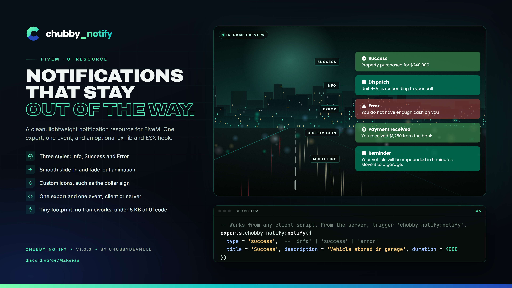

<div align="center">




# chubby_notify

Small notifications for FiveM. Info, success and error, no dependencies.


[Dansk](README.md) · **English** · [Discord](https://discord.gg/vwe8b8fnRm)

</div>

---

chubby_notify shows short messages at the side of the screen. They slide in, stay for a few seconds and fade out. It uses no frameworks and loads nothing from the internet: the font (Poppins) is bundled.

## Features

- Three types: info, success and error, each with its own colour and icon
- One extra icon, `dollar`, for money
- Eight screen positions
- Multi-line messages with `\n`
- One export for client scripts and one event for server scripts
- Strips GTA colour codes (`~r~`, `~g~`, `~n~` and so on) from the text
- Limits duration and text length, and renders text as plain text, so HTML in a message does nothing
- Caps the number of visible notifications: the oldest one is removed when there are too many

The default titles are Danish (`Succes`, `Fejl`). Change them in `config.lua`.

## Installation

1. Download the latest version from [Releases](../../releases) and unzip it.
2. Put the `chubby_notify` folder in your `resources`.
3. Add `ensure chubby_notify` to `server.cfg` and restart the server.

There are no dependencies.

## Usage

From a client script:

```lua
exports.chubby_notify:notify({
    type = 'success',
    title = 'Success',
    description = 'The car is in the garage',
    duration = 5000,
})
```

From a server script:

```lua
TriggerClientEvent('chubby_notify:notify', source, {
    type = 'error',
    description = 'You do not have enough cash',
})
```

| Field | Meaning |
|---|---|
| `type` | `'info'` (default), `'success'` or `'error'`. ox_lib's `'inform'` and `'warning'` are shown as info |
| `title` | Heading. If left out, the text from `Config.Titles` is used |
| `description` | The message. `\n` gives a line break |
| `duration` | How long it stays, in milliseconds |
| `icon` | Only `'dollar'` exists. Without `icon`, the notification uses the icon of its type |

The title is cut at 60 characters and the message at 300.

GTA colour codes are removed from the text, and `~n~` becomes a line break. If the call has no `type`, the colour code picks one: `~r~` gives error and `~g~` gives success.

## Configuration

Everything is in `config.lua`.

| Setting | Default | Meaning |
|---|---|---|
| `Config.Position` | `'right-center'` | `right-center`, `left-center`, `top-right`, `top-left`, `bottom-right`, `bottom-left`, `top-center` or `bottom-center` |
| `Config.MaxVisible` | `5` | More than this at once and the oldest is removed |
| `Config.DefaultDuration` | `4000` | Duration when the call does not give one |
| `Config.MinDuration`, `Config.MaxDuration` | `1000`, `30000` | Limits for the duration |
| `Config.Titles` | `Info`, `Succes`, `Fejl` | Headings when no title is given |

## With ox_lib and ESX

chubby_notify does not take over ox_lib or ESX notifications on its own. To get that, add one call to each of the two scripts.

**ox_lib.** In `ox_lib/resource/interface/client/notify.lua`, `lib.notify` passes the message on to its own UI. Use this instead of `SendNUIMessage`:

```lua
if GetResourceState('chubby_notify') == 'started' then
    exports.chubby_notify:notify(payload)
else
    SendNUIMessage({ action = 'notify', data = payload })
end
```

**ESX.** In ESX Legacy 1.16, `ESX.ShowNotification` sends its message to ox_lib (the `ox_lib:notify` event), so it follows once ox_lib is patched. `ESX.ShowAdvancedNotification` uses GTA's own feed. To include it, add this at the top of the function (in `es_extended/client/modules/ui/notifications.lua`):

```lua
if GetResourceState('chubby_notify') == 'started' then
    exports.chubby_notify:notify({
        type = 'info',
        title = sender ~= '' and sender or subject,
        description = (sender ~= '' and subject and subject ~= '') and (subject .. '\n' .. msg) or msg,
        duration = 6000,
    })
    return
end
```

An update of ox_lib or ESX overwrites the change, so it has to be added again.

## Try it

Add a command to a client script and type `/notifytest` in game:

```lua
RegisterCommand('notifytest', function()
    exports.chubby_notify:notify({ type = 'success', description = 'It works' })
    exports.chubby_notify:notify({ type = 'info', description = 'A plain message' })
    exports.chubby_notify:notify({ type = 'error', description = 'Something went wrong' })
    exports.chubby_notify:notify({ type = 'success', icon = 'dollar', title = 'Payment', description = 'You received $1,250' })
end)
```

## Support

Report bugs and requests as an [issue](../../issues). For questions, join the Chubby Development server on Discord, <https://discord.gg/vwe8b8fnRm>, or message me directly: `freddie.bs`.

## License

MIT. See [LICENSE](LICENSE). The Poppins font has its own license (SIL Open Font License) in [web/fonts/OFL.txt](web/fonts/OFL.txt).

Made by ChubbyDevNull.
