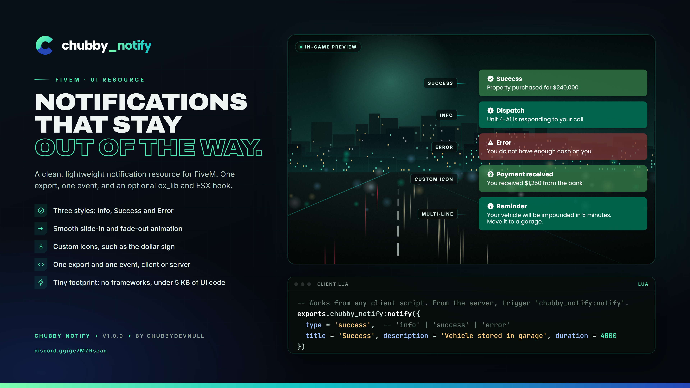
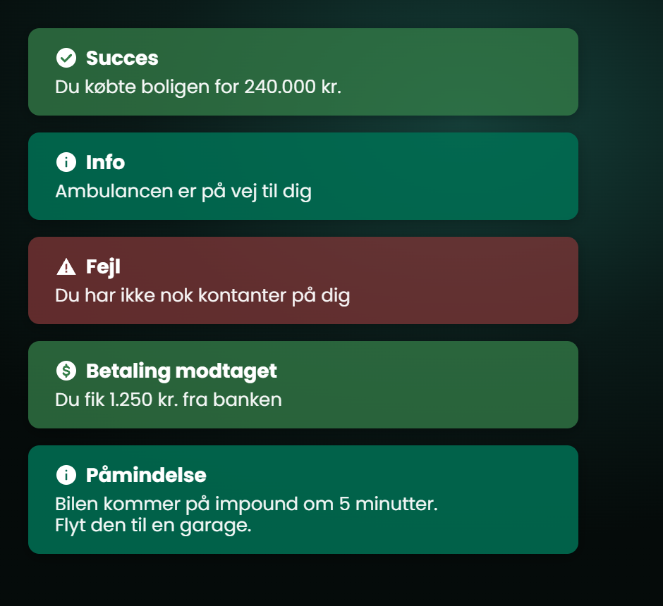

<div align="center">




# chubby_notify

Små notifikationer til FiveM. Info, succes og fejl, uden afhængigheder.


[Discord](https://discord.gg/ge7MZRseaq) · [English below](#english)

</div>

---

chubby_notify viser korte beskeder i siden af skærmen. De glider ind, står et par sekunder og forsvinder igen. Scriptet bruger ingen frameworks og henter ingenting fra internettet: skrifttypen (Poppins) ligger i mappen.

<p align="center"></p>

## Det kan scriptet

- Tre typer: info, succes og fejl, hver med sin farve og sit ikon
- Et ekstra ikon, `dollar`, til penge
- Otte placeringer på skærmen
- Flere linjer i samme besked med `\n`
- Én export til klient-scripts og ét event til server-scripts
- Rydder GTA's farvekoder (`~r~`, `~g~`, `~n~` m.fl.) fra teksten
- Begrænser varighed og tekstlængde, og viser teksten som ren tekst, så HTML i en besked ikke gør noget
- Begrænser antallet på skærmen: den ældste fjernes, når der er for mange

## Installation

1. Hent den nyeste version under [Releases](../../releases) og pak den ud.
2. Læg mappen `chubby_notify` i dine `resources`.
3. Skriv `ensure chubby_notify` i `server.cfg`, og genstart serveren.

Scriptet har ingen afhængigheder.

## Brug

Fra et klient-script:

```lua
exports.chubby_notify:notify({
    type = 'success',
    title = 'Succes',
    description = 'Bilen står i garagen',
    duration = 5000,
})
```

Fra et server-script:

```lua
TriggerClientEvent('chubby_notify:notify', source, {
    type = 'error',
    description = 'Du har ikke nok kontanter',
})
```

| Felt | Betydning |
|---|---|
| `type` | `'info'` (standard), `'success'` eller `'error'`. ox_lib's `'inform'` og `'warning'` vises som info |
| `title` | Overskrift. Udelades den, bruges teksten fra `Config.Titles` |
| `description` | Selve beskeden. `\n` giver et linjeskift |
| `duration` | Hvor længe den står, i millisekunder |
| `icon` | Kun `'dollar'` findes. Uden `icon` får notifikationen ikonet for sin type |

Titlen afkortes ved 60 tegn og beskeden ved 300.

GTA's farvekoder fjernes fra teksten, og `~n~` bliver til et linjeskift. Angiver kaldet ikke en `type`, bruges farvekoden til at vælge den: `~r~` giver fejl og `~g~` giver succes.

## Indstillinger

Alt står i `config.lua`.

| Indstilling | Standard | Betydning |
|---|---|---|
| `Config.Position` | `'right-center'` | `right-center`, `left-center`, `top-right`, `top-left`, `bottom-right`, `bottom-left`, `top-center` eller `bottom-center` |
| `Config.MaxVisible` | `5` | Flere end det på én gang, og den ældste fjernes |
| `Config.DefaultDuration` | `4000` | Varighed, når kaldet ikke angiver en |
| `Config.MinDuration`, `Config.MaxDuration` | `1000`, `30000` | Grænser for varigheden |
| `Config.Titles` | `Info`, `Succes`, `Fejl` | Overskrifter uden titel. Skriv dem om, hvis du vil have et andet sprog |

## Sammen med ox_lib og ESX

chubby_notify overtager ikke ox_lib's eller ESX's notifikationer af sig selv. Vil du have det, skal der sættes et kald ind i de to scripts.

**ox_lib.** I `ox_lib/resource/interface/client/notify.lua` sender `lib.notify` beskeden videre til sin egen visning. Sæt dette ind i stedet for `SendNUIMessage`:

```lua
if GetResourceState('chubby_notify') == 'started' then
    exports.chubby_notify:notify(payload)
else
    SendNUIMessage({ action = 'notify', data = payload })
end
```

**ESX.** I ESX Legacy 1.16 sender `ESX.ShowNotification` sin besked til ox_lib (eventet `ox_lib:notify`), så den følger med, når ox_lib er rettet. `ESX.ShowAdvancedNotification` bruger GTA's eget feed. Vil du have den med, så sæt dette øverst i funktionen (i `es_extended/client/modules/ui/notifications.lua`):

```lua
if GetResourceState('chubby_notify') == 'started' then
    exports.chubby_notify:notify({
        type = 'info',
        title = sender ~= '' and sender or subject,
        description = (sender ~= '' and subject and subject ~= '') and (subject .. '\n' .. msg) or msg,
        duration = 6000,
    })
    return
end
```

En opdatering af ox_lib eller ESX overskriver ændringen, så den skal sættes ind igen.

## Prøv det af

Læg en kommando i et klient-script, og skriv `/notifytest` i spillet:

```lua
RegisterCommand('notifytest', function()
    exports.chubby_notify:notify({ type = 'success', description = 'Det virker' })
    exports.chubby_notify:notify({ type = 'info', description = 'En almindelig besked' })
    exports.chubby_notify:notify({ type = 'error', description = 'Noget gik galt' })
    exports.chubby_notify:notify({ type = 'success', icon = 'dollar', title = 'Betaling', description = 'Du fik 1.250 kr.' })
end)
```

## Hjælp og kontakt

Fejl og ønsker oprettes som [issue](../../issues). Til spørgsmål er der Chubby Development-serveren på Discord, <https://discord.gg/ge7MZRseaq>. Du kan også skrive direkte til mig: `freddie.bs`.

<a name="english"></a>

<details>
<summary><b>English</b></summary>

chubby_notify shows short messages at the side of the screen. They slide in, stay for a few seconds and fade out. It uses no frameworks and loads nothing from the internet: the font (Poppins) is bundled.

### Features

- Three types: info, success and error, each with its own colour and icon
- One extra icon, `dollar`, for money
- Eight screen positions
- Multi-line messages with `\n`
- One export for client scripts and one event for server scripts
- Strips GTA colour codes (`~r~`, `~g~`, `~n~` and so on) from the text
- Limits duration and text length, and renders text as plain text, so HTML in a message does nothing
- Caps the number of visible notifications: the oldest one is removed when there are too many

The default titles are Danish (`Succes`, `Fejl`). Change them in `config.lua`.

### Installation

1. Download the latest version from [Releases](../../releases) and unzip it.
2. Put the `chubby_notify` folder in your `resources`.
3. Add `ensure chubby_notify` to `server.cfg` and restart the server.

There are no dependencies.

### Usage

From a client script:

```lua
exports.chubby_notify:notify({
    type = 'success',
    title = 'Success',
    description = 'The car is in the garage',
    duration = 5000,
})
```

From a server script:

```lua
TriggerClientEvent('chubby_notify:notify', source, {
    type = 'error',
    description = 'You do not have enough cash',
})
```

| Field | Meaning |
|---|---|
| `type` | `'info'` (default), `'success'` or `'error'`. ox_lib's `'inform'` and `'warning'` are shown as info |
| `title` | Heading. If left out, the text from `Config.Titles` is used |
| `description` | The message. `\n` gives a line break |
| `duration` | How long it stays, in milliseconds |
| `icon` | Only `'dollar'` exists. Without `icon`, the notification uses the icon of its type |

The title is cut at 60 characters and the message at 300.

GTA colour codes are removed from the text, and `~n~` becomes a line break. If the call has no `type`, the colour code picks one: `~r~` gives error and `~g~` gives success.

### Configuration

Everything is in `config.lua`.

| Setting | Default | Meaning |
|---|---|---|
| `Config.Position` | `'right-center'` | `right-center`, `left-center`, `top-right`, `top-left`, `bottom-right`, `bottom-left`, `top-center` or `bottom-center` |
| `Config.MaxVisible` | `5` | More than this at once and the oldest is removed |
| `Config.DefaultDuration` | `4000` | Duration when the call does not give one |
| `Config.MinDuration`, `Config.MaxDuration` | `1000`, `30000` | Limits for the duration |
| `Config.Titles` | `Info`, `Succes`, `Fejl` | Headings when no title is given |

### With ox_lib and ESX

chubby_notify does not take over ox_lib or ESX notifications on its own. To get that, add one call to each of the two scripts.

**ox_lib.** In `ox_lib/resource/interface/client/notify.lua`, `lib.notify` passes the message on to its own UI. Use this instead of `SendNUIMessage`:

```lua
if GetResourceState('chubby_notify') == 'started' then
    exports.chubby_notify:notify(payload)
else
    SendNUIMessage({ action = 'notify', data = payload })
end
```

**ESX.** In ESX Legacy 1.16, `ESX.ShowNotification` sends its message to ox_lib (the `ox_lib:notify` event), so it follows once ox_lib is patched. `ESX.ShowAdvancedNotification` uses GTA's own feed. To include it, add this at the top of the function (in `es_extended/client/modules/ui/notifications.lua`):

```lua
if GetResourceState('chubby_notify') == 'started' then
    exports.chubby_notify:notify({
        type = 'info',
        title = sender ~= '' and sender or subject,
        description = (sender ~= '' and subject and subject ~= '') and (subject .. '\n' .. msg) or msg,
        duration = 6000,
    })
    return
end
```

An update of ox_lib or ESX overwrites the change, so it has to be added again.

### Try it

Add a command to a client script and type `/notifytest` in game:

```lua
RegisterCommand('notifytest', function()
    exports.chubby_notify:notify({ type = 'success', description = 'It works' })
    exports.chubby_notify:notify({ type = 'info', description = 'A plain message' })
    exports.chubby_notify:notify({ type = 'error', description = 'Something went wrong' })
    exports.chubby_notify:notify({ type = 'success', icon = 'dollar', title = 'Payment', description = 'You received $1,250' })
end)
```

### Support

Report bugs and requests as an [issue](../../issues). For questions, join the Chubby Development server on Discord, <https://discord.gg/ge7MZRseaq>, or message me directly: `freddie.bs`.

</details>

## Licens

MIT. Se [LICENSE](LICENSE). Skrifttypen Poppins har sin egen licens (SIL Open Font License) i [web/fonts/OFL.txt](web/fonts/OFL.txt).

Lavet af ChubbyDevNull.
